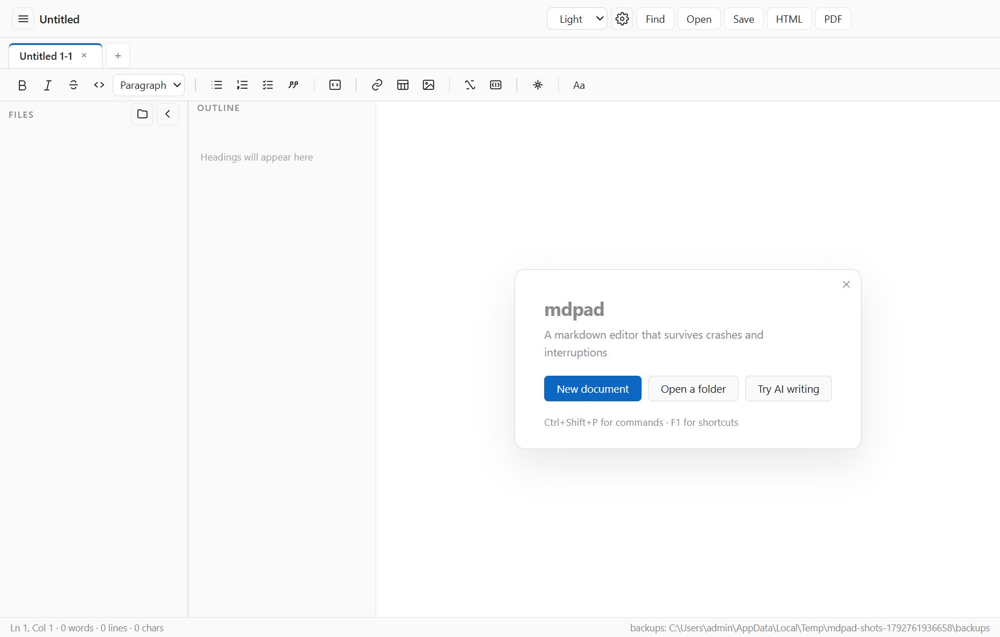

# mdpad

A WYSIWYG markdown editor for Windows, built on Tiptap (ProseMirror) with a
crash-safe save pipeline: atomic writes with a leading-edge draft (the first change of a burst hits disk immediately, plus flushes on blur, quit and sleep), timestamped backup rotation, debounced
autosave, crash-draft recovery, tabs, a file tree, and AI writing.

- [User guide](docs/USER_GUIDE.md) — editing, exports, AI setup, shortcuts, troubleshooting
- [Development and release](docs/DEVELOPING.md) — architecture, tests, packaging, platform notes
- [Signing and updates](docs/RELEASING.md) — certificate, update feed, release checklist
- [Changelog](CHANGELOG.md)

## Quick start

```bash
npm install
npm start
```

Or install the built artifact: `release/mdpad Setup <version>.exe`.

## What it does

| Area | Summary |
| --- | --- |
| Editing | find with a grouped bar (search field, counter, replace field, icon navigation) and a bounded match list; WYSIWYG markdown with a `/` block menu (headings, lists, table, image, math, divider, diagram): headings, lists, tables (resizable columns, a drag grip that reorders rows, a right-click cell menu with row move and header toggle, Tab in the last cell appends a row), code with highlighting, KaTeX math (centred display blocks, hover cue, live preview, click-to-edit), Mermaid diagrams that replace their fence and open for editing on click (Esc previews again), images with size/alignment and a corner handle that resizes them by dragging, task lists, pasting a URL over a selection links it, Ctrl+click opens links in the browser (a plain click just places the caret) |
| Files | drag-reorderable tabs with per-tab undo history and scroll position, a tab right-click menu (close, close others, close to the right, copy path, show in folder) and Ctrl+Tab cycling (Ctrl+T, reopen with Ctrl+Shift+T), command-line files opened as tabs, multiple windows (Ctrl+Shift+N), lazy file tree (Ctrl+K), recent files, multi-window session restore with truncation notice and crash-loop protection |
| Safety | atomic save with a transient-lock retry, 20-version backup rotation with one-click restore, crash drafts with relative age, a recovery panel with per-draft delete and confirmed cleanup, read-only protection, save-failure recovery with Retry, close guard |
| Export | one panel for format, template, document font, page margins and file name, with a real rendered page thumbnail (not a sketch) and a live summary before writing; HTML, PDF (page numbers, verified to paginate), Word and EPUB with their document parts opened and checked; default / compact / table-of-contents templates with a live thumbnail, optional custom CSS, in-app preview with zoom and Esc-to-close that follows the editor theme, an Open / Show-in-folder prompt after each export, word/character footer, name template |
| AI | Ctrl+J panel ordered target → instruction → suggestions → result → actions, with a target chip and a highlighted range that answer "what will this act on?", a quoted preview of the target text, and an Undo action in the toast after every AI edit; against any OpenAI-compatible endpoint; presets, streaming with a self-scrolling result box, Stop, word-level diff review, Retry, persistent context that expires after 30 days, token guard before expensive requests, failure cooldown, local usage log with CSV export reachable from the panel, connection test, a scrolling AI settings pane with the key under the endpoint and a Clear button, endpoint normalisation (a bare host is retried against /v1), custom style guidance, history chips with arrow-key navigation, insert as inline text or a new paragraph, replace the current paragraph, scrolls into view, selectable context scope that is remembered and never auto-narrows once chosen, large-export warning |
| Workspace | split a saved document into two real windows tiled on the two halves of the display (View menu, palette, Ctrl+Alt+2) and merge them back with the original window size (Ctrl+Alt+1), each window editing the same file with its own scroll position |
| Polish | one design scale for control heights, radii and motion; toolbar active states, a tab indicator, one stroke icon set across the chrome (no emoji), thin theme-aware scrollbars, file-tree rows with relative modification times, a right-click menu to create, rename and delete files and folders (with confirmation), an action-first empty tree, an outline that counts headings and marks the section holding the caret, sidebar and outline hover/active states, a composed empty state, visible focus rings, a theme-swap transition guard and prefers-reduced-motion support; window minimum size with a narrow layout (sidebars shrink, export shortcuts leave the top bar, the toolbar fades to show it scrolls), responsive AI panel (readable scope control, scroll-hinted presets) and sidebars, consistent SVG toolbar icons grouped by purpose, command palette with shortcuts, match highlighting and usage ranking, recent files, shortcut help grouped by area, statistics with aligned tabular numbers, a backup list with relative ages and sizes, a drafts panel with per-row restore and delete, first-run guide (dismissible for good), collapsible Export/AI/Usage settings sections whose state is remembered, a filter that matches section names, with an unsaved-changes hint, a live export-name example and labelled history chips, WCAG contrast audit per theme, theme-aware overlay shadows, focus mode (View menu, Ctrl+Shift+K) that dims everything but the current block, including lighting a whole table from a cell, adapts to the theme and works with find, a Saving…/Saved/Unsaved indicator with separated status items, a zoom indicator with Ctrl+= / Ctrl+- / Ctrl+0, a spelling checker toggle with native suggestions on right click, statistics with selection size and last-saved time, light/dark/sepia themes plus **Follow system** (live), Esc closing every dialog and returning focus to the editor, ten editor fonts, three text widths and four accent colours, five typography presets (Book, Report, Minimal, Technical, Chinese) that set the three together, an Aa toolbar button and palette entry that open Appearance directly, a collapsible file tree that keeps a rail, F11 full screen that Esc exits, localised table/image bars, light/dark/sepia themes, English and 简体中文 |

## Quality gates

```
npm test              155 unit tests
npm run smoke         301 end-to-end checks (dev or packaged)
npm run crash         SIGKILL -> restart -> draft recovery
npm run restart-check clean quit -> relaunch -> two windows and their tabs restored
npm run release-check build -> package -> packaged smoke -> crash -> portable
npm run install-check install -> smoke installed app -> uninstall -> clean
npm run ship          release-check -> installers -> install-check -> SHA256SUMS
```

Current artifacts: `release/mdpad Setup <version>.exe`, `release/mdpad <version>.exe`,
`release/latest.yml`, `release/RELEASE_NOTES.md`.

## First run

A blank untitled tab shows a four-step welcome checklist — start writing, open a folder, insert a
block, export — where each step performs the action rather than describing it ("Insert a block"
types `/` for you). It can be skipped for good, and **Help → Welcome guide** brings it back. An
empty *saved* file is never covered by it.



## Diagnostics

**Help → Copy diagnostics** (also in Settings) puts version, Electron/Chromium versions, paths,
settings summary and the last 60 log lines on the clipboard. No telemetry, no network: you paste it
into a report yourself. **Open log folder** shows the same file. The log path is
`<userData>/logs/mdpad.log`.

## Signing and updates

The build pipeline can sign: set `CSC_LINK` and `CSC_KEY_PASSWORD` (or run
`npm run cert` for a self-signed development certificate) and `npm run ship` signs the app,
installer and uninstaller, then *fails the build* if an artifact lost its signature. The
difference between "signed" and "trusted by Windows" is reported separately — a self-signed
signature is real but SmartScreen still warns. See [docs/RELEASING.md](docs/RELEASING.md).

### Links in exports

Exports keep links honest: a relative link whose file exists stays untouched, one that does not
is flagged (`data-link-missing`, wavy underline, "File not found" tooltip), anchors keep matching
heading ids, and absolute URLs become real hyperlinks in Word.

## Links between files

`[text](other.md)` opens that file in a tab (relative to the current document, `.md` guessed when
omitted), `[text](#heading)` scrolls to the heading, and a missing target says so instead of
doing nothing. Ctrl+click still sends real URLs to the system browser.

## Recent files panel

**File → Show all recent files…** (or the palette) lists recent documents newest first with
their folder and age, removes entries, and clears the list. A file deleted behind the app's back
stays in the list marked **missing** instead of silently vanishing, and opening it says so.

## Jump history

**Alt+Left / Alt+Right** walk back and forward through the places you jumped from — an outline
click, a find step — per tab. A new jump truncates the forward stack, the way a browser does.

## Outline that folds

The outline panel folds sections (a twisty on any heading with children) and marks the heading at
the top of the viewport while you scroll, not only the one under the caret.

## Block handle

Hovering a block shows a handle in the gutter with a menu: **move up / down**, **duplicate**,
**delete**. Ctrl+Shift+↑/↓ moves the current block from the keyboard, and the caret stays at the same
offset inside the block that moved — one undo puts it back.

## Quotes and nesting

Nested quotes (`> >`) round-trip, a selection of several blocks becomes one quote, and **Tab** nests
a quote while **Shift+Tab** lifts it. Ctrl+] / Ctrl+[ do the same for lists and quotes without
stealing Tab from list indentation.

## Task lists

`- [ ]` and `- [x]` round-trip through the editor, clicking a box writes the new state back to the
markdown, and exports keep it: HTML and EPUB render real checkboxes, Word gets ☐ / ☑ because it has
no checkbox primitive here.

## Find and replace

Find with match case (**Aa**), whole word (**ab**) and regular expressions (**.***), toggled from the
bar or with Alt+C / Alt+W / Alt+R. Replace one or all; in regex mode the replacement expands
`## Typing and pasting markdown` and `$1…$9`. The whole batch is a single undo step, isolated from the typing that came before
it. Ctrl+H opens the bar in its replace field. Options are remembered.

## Typing and pasting markdown

Typing markdown converts as you go: `# `, `- `, `1. `, `> ` and fences are blocks, and
`**bold**`, `*italic*`, `~~strike~~`, ```code``` become marks on the closing delimiter.
Pasting **plain text that is clearly markdown** (a fence, a table rule, a heading with a blank line,
two or more list items) parses it; prose and a lone `#tag` stay literal.

## Before you export

The export panel counts what is about to be written — words, headings, images, tables,
diagrams, formulas, tasks — and warns about images or links whose target is missing, so a
broken document is visible before the file is produced.

## Three export templates

**default**, **compact** (tighter spacing, narrow margins) and **with contents** (a linked table
of contents, localised, with page breaks before the body). Each has a rendered screenshot in
`docs/images/` so the typography can be reviewed without opening a PDF.

## Export consistency

One document exported to HTML, PDF, Word and EPUB is checked block by block — heading, bold text,
table, image, maths, code and diagram — plus the order they appear in. EPUB chapters now carry a
visible `<h1>` (the title used to live only in `<title>`), and Word keeps a Mermaid block as its
source, which is stated in the known limitations instead of being papered over.

## Images

Pasted and dropped images are downscaled to 2200 px on the long edge and re-encoded in the smaller
of JPEG and PNG (JPEG for photos, PNG for screenshots of text), then written to `assets/` next to
the document. An 8.9 MB photo becomes about 110 KB with no visible loss at document size; the toast
reports the saving.

## Extracting old images

Documents written before the image pipeline can still carry pasted pictures as data URLs.
**File → Extract embedded images…** (also in the command palette) writes them into `assets/` and
rewrites the references, through a backup. It refuses while the document has unsaved changes, so it
can never destroy text you are still editing.

## Performance

A 14 000-word document opens in ~190 ms, rebuilds its outline in ~6 ms and costs ~4.8 ms per
keystroke; PDF export takes ~0.5 s. Measured with `npm run perf`; method and caveats in
[docs/PERFORMANCE.md](docs/PERFORMANCE.md).

## Advanced settings

Settings → **Advanced**: export preferences to JSON (never the AI key), import them back, open the
data folder, clear recovery drafts with a count, and reset every preference to its default —
documents, backups and drafts on disk are untouched.

## Concurrency

Opening a file that another window already shows focuses that window instead of creating a second
editor. If a file changes on disk (another window, another app, a sync client), a save refuses to
clobber it: the dialog offers **Overwrite**, and autosave stays dirty instead of pretending to
save. Saving is never silent about losing someone else's work.

## Keyboard and screen readers

The tab strip is a tablist: arrow keys move and activate, Home/End jump, Delete closes, and exactly one tab is selected with a roving `tabindex`. Re-rendering the strip no longer drops the keyboard back to the page. The editor is a named textbox (`role="textbox"`, `aria-multiline`, a localised label) and the outline marks the section containing the caret with `aria-current="location"`, with `aria-expanded` on every foldable heading. Dialogs are real dialogs: `role="dialog"`, `aria-modal`, labelled by their title, and **Tab is
trapped inside** while one is open; Escape returns focus to the editor. Toolbar toggles expose
`aria-pressed`, and every icon button gets an accessible name from its tooltip.

## Multiple windows stay in sync

A settings change (theme, language, accent, typography, hidden file tree) is broadcast to every
open window, including the one that made it. Closing a window leaves the others editing normally.

## Recovery paths are verified

Restoring a backup and saving again is asserted end to end (the replaced version becomes the
next backup), and a recovery draft whose original file was deleted restores into a **new tab**
instead of overwriting whatever is open.

## When something goes wrong

When the backups folder cannot be written, saving still succeeds and a banner says **"Backups are off"** — protection degrades instead of blocking the save. A drafts folder that cannot be written raises a **persistent banner** ("Recovery drafts are off: <reason>") with a shortcut to the data folder; the next successful write clears it. A failed export answers with an error and shows a **Retry** banner instead of throwing into the
console. An unreadable `settings.json` is copied to `settings.json.corrupt-<timestamp>` before
the app continues with defaults, so a broken file is never overwritten silently.

## Known limitations

- **The installer is unsigned** — SmartScreen warns, and update download/install is
  disabled until releases are signed and a feed exists (checks work).
- The API key is encrypted via the OS credential store; on systems without one it
  degrades to base64 wrapping, and Settings says so.
- Markdown round-trip covers the modeled nodes; raw HTML blocks and footnotes are not
  modeled, so exotic documents may normalize on first save.
- Word and EPUB embed local images; both leave remote image URLs as alt text.
- File operations are confined to the opened folder: names with separators, `..`, duplicates
  and paths outside the tree are refused by the main process, not only by the dialog.
- Column widths are editor-only: markdown has no syntax for them, so they are kept while the
  document is open and not written to the file.
- Table cell alignment is a view and export setting: markdown tables only describe column
  alignment, so per-cell `text-align` is kept in the editor and in HTML/PDF exports but not in
  the `.md` file.
- Mermaid diagrams are embedded as SVG in HTML, PDF and EPUB exports. Word (.docx) still keeps
  the fenced source, because the Word writer needs a raster image and converting SVG to PNG is a
  separate piece of work.
