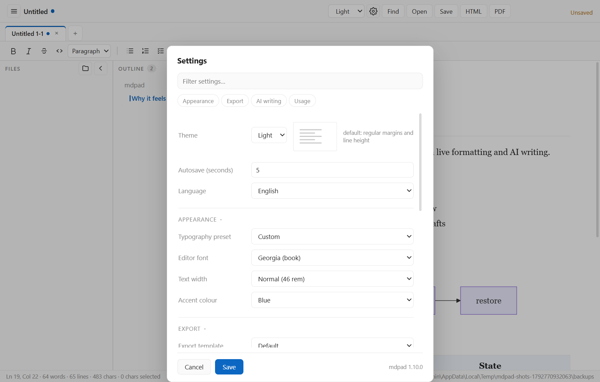
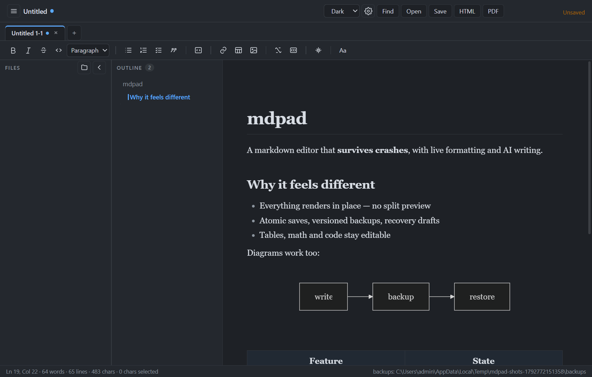
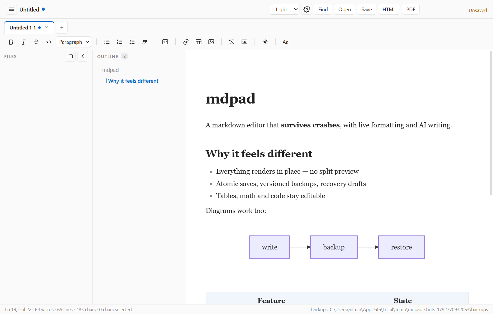
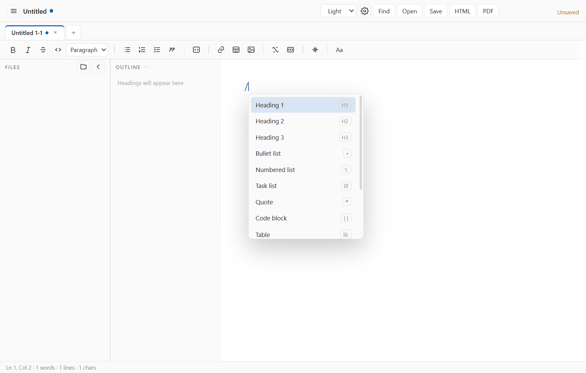
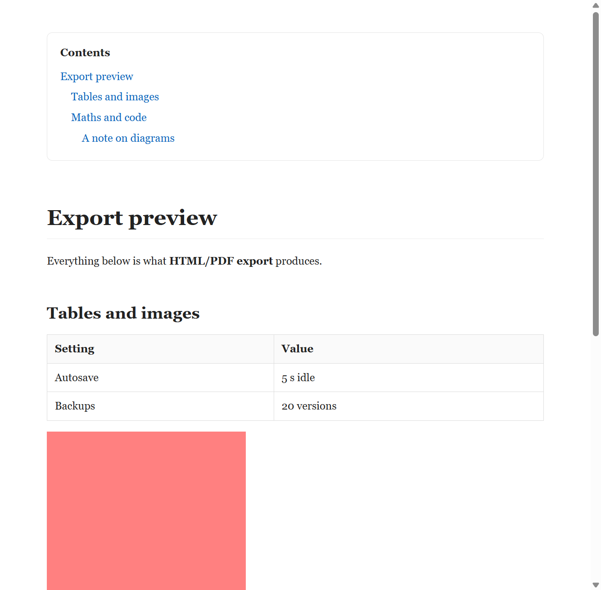
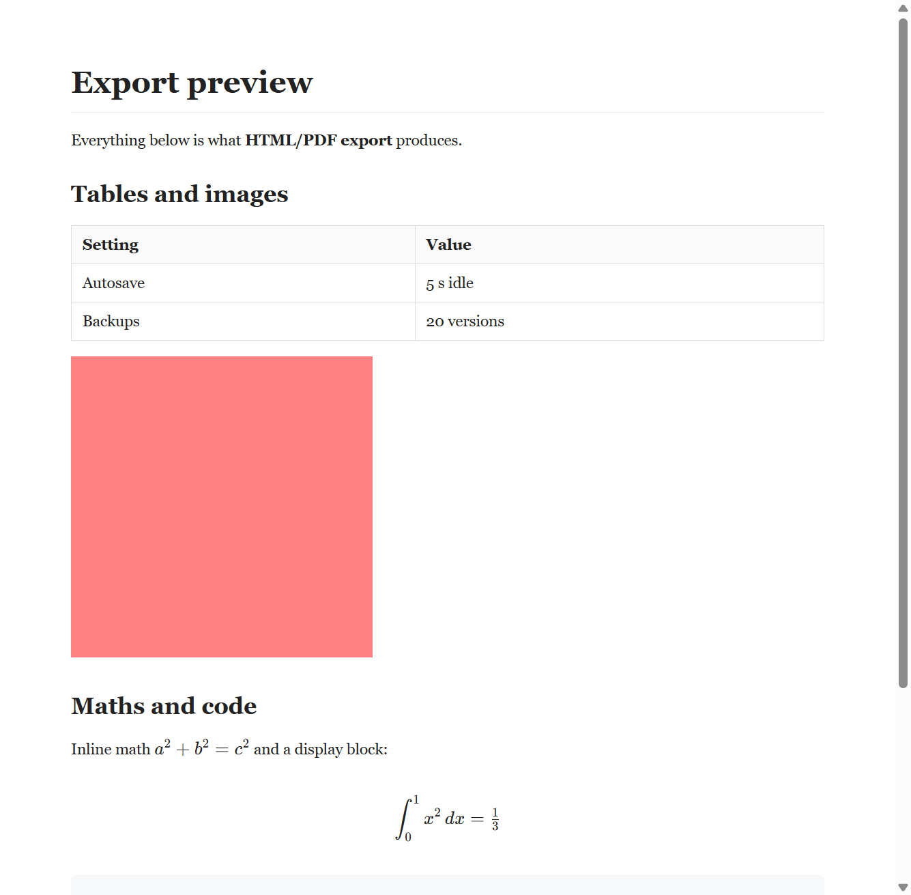
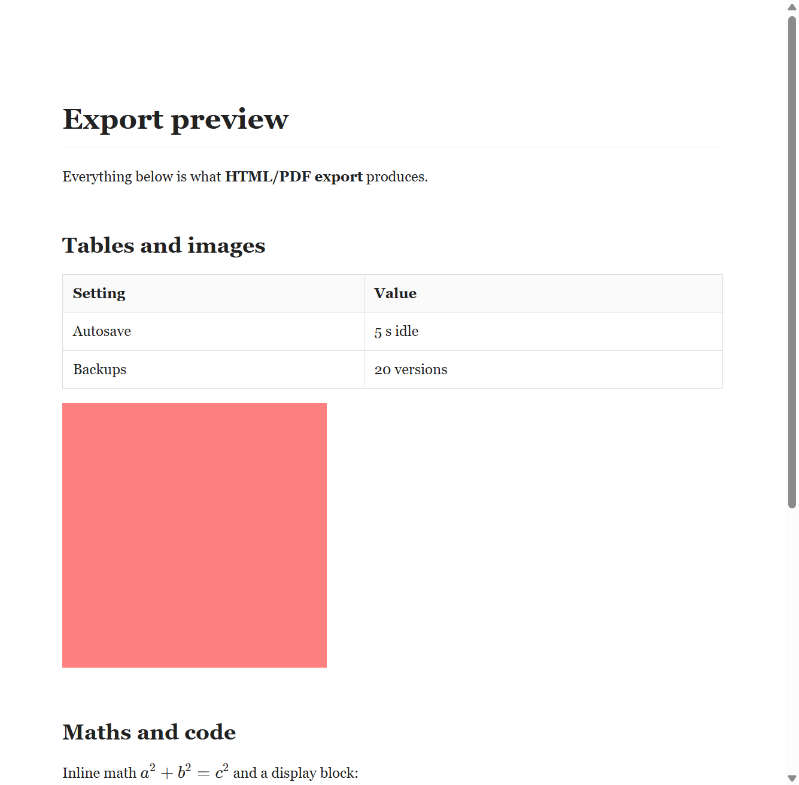
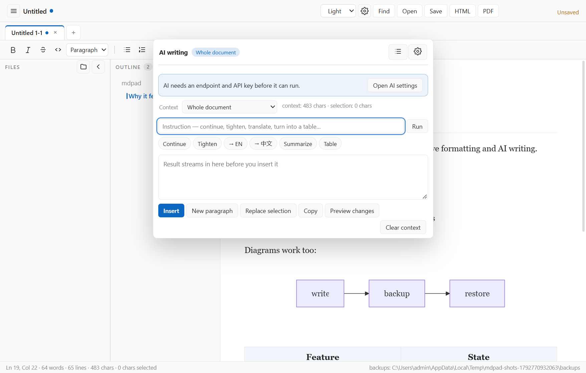
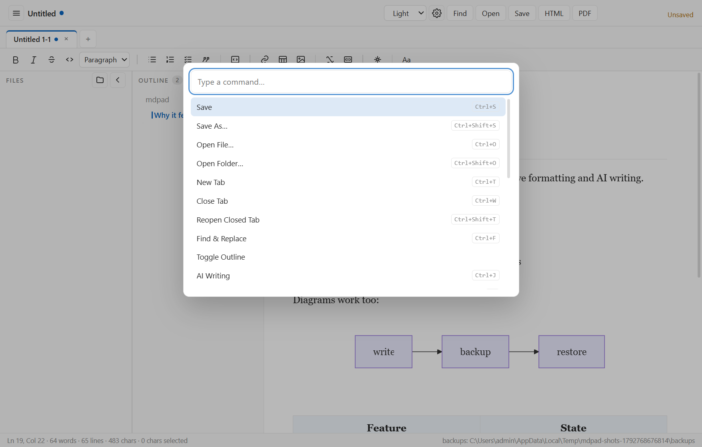

# mdpad — user guide

## Install and first run

Run `mdpad Setup <version>.exe` (per-user install, no admin rights) or the portable
`mdpad <version>.exe`. The first empty document shows a guide with three actions:
new document, open a folder, or try AI writing.


The first launch shows a one-time hint pointing at AI setup (Ctrl+J) and the update
check; dismiss it and it never returns. The empty-document card has its own × button: once
closed it stays closed, including on new empty tabs.

Settings shows **Unsaved changes** as soon as a field differs from what is stored, and
Cancel discards them, so it is clear whether Save is needed.

Section headings in Settings fold, and the folded state is remembered between visits.
The interface language follows your system locale on first run and can be changed in
Settings (⚙ or Ctrl+,).



Overlays use a theme-aware shadow and border (a soft light-mode shadow turns into a grey
smudge on a dark page).

**Where the font lives.** The **Aa** button at the right end of the toolbar (or the palette
entry "Change font and page width") opens Settings at the Appearance section: preset, editor
font, text width and accent colour.

**Typography presets.** Instead of juggling three settings, pick a preset: Book (serif, warm
accent), Report (Cambria, blue), Minimal (sans, wide), Technical (Arial, teal) or Chinese
(微软雅黑). Each sets the font, width and accent together; the individual controls stay available
underneath for tweaking.

**Appearance.** Settings offers ten editor fonts (Georgia, Segoe UI, 微软雅黑, 宋体, 楷体, 仿宋,
Times New Roman, Arial, Cambria, Consolas), a text width
(narrow 34 rem, normal 46 rem, wide 58 rem) and four accent colours; all three apply
immediately on save and are remembered.

**Files.** Right-click in the file tree: on a folder for **New file** / **New folder**, on any
row for **Rename**, **Show in folder** or **Delete**. Deleting asks first; a folder with contents
asks again before removing everything inside. Names containing separators, ".." or an existing
file are refused by the app, and nothing outside the opened folder can be touched.

**Sidebars.** File rows show how long ago each file changed (hover for the exact timestamp),
and an empty tree offers **Open a folder** instead of a sentence. The outline header counts the
headings in the document and the section that currently holds the caret is marked with an accent
rule, so you can see where you are without reading the text.

**File tree.** The ◀ button in the Files header hides the tree; a 34 px rail stays behind with a ▶ button, so
a collapsed tree is always recoverable, and the state survives a restart.

**Sidebars.** File rows show how long ago each file changed (hover for the exact timestamp), and an
empty tree offers **Open a folder** instead of a sentence. The outline header counts the headings in
the document, and the section that currently holds the caret is marked with an accent rule, so you
can see where you are without reading the text.

**Tables.** Hover a row and a grip appears on its left edge; drag it to move that row. Right-click any cell for the full table menu: add a row or column on either side, move the row
up or down, toggle the header row, or delete the row, column or table. Column borders can be
dragged; widths are a view setting (markdown has no syntax for them). Hover a table to get a small toolbar with add row, add column and the two delete
actions, so a table can be edited without visiting the bar. Pressing Tab in the last cell appends a row, the way Notion does. The bar above the editor
carries the same actions plus alignment (left, centre, right) for the selected cell. Alignment is a view
setting: markdown can only describe column alignment, so it survives in the editor and in
HTML/PDF exports but not in the .md file.

Settings groups its fields into **Export**, **AI writing** and **Usage**, each of which folds
and remembers its state.

Overlays (settings, palettes, popovers) use a theme-aware shadow and border: the soft light-mode
shadow turns into a grey smudge on a dark page, so dark mode gets a tighter, deeper shadow and a
brighter hairline instead.

Light, dark and sepia themes (body text keeps a WCAG AA contrast ratio in all three):



## Editing

Formatting happens in place — there is no separate preview pane. The toolbar keeps one
stroke icon set (with tooltips and accessible labels) instead of platform-dependent glyphs,
and clusters them by purpose — text style, block style, lists, code, insert, math, AI.



| Want | Do |
| --- | --- |
| Headings | type `## ` at the start of a line, or use the paragraph-style dropdown |
| Bold / italic / strike / code | toolbar buttons or the usual markdown shortcuts |
| Lists, quotes | `- `, `1. `, `> `, or the toolbar |
| Table | toolbar ▦ inserts 3×3; the context bar adds/removes rows and columns |
| Code block | toolbar `{ }`; the language dropdown writes the fence language |
| Math | toolbar `$x$` / `$$`, or type `$...$` / `$$...$$` directly; the popover previews as you type, and clicking a rendered formula reopens it for editing. Display math is centred with a hover highlight |
| Diagram | a fenced block with language `mermaid` becomes the rendered diagram — click it to edit the source, press Esc (or click outside) to go back to the picture; a broken diagram keeps its source visible with the error underneath |
| Image | paste or drag a file in; hover the picture and drag the corner handle to resize it (the same w=NN% metadata the toolbar buttons write), or use the image bar for exact presets and alignment |
| Link | toolbar 🔗; paste a URL over a selection to link it; Ctrl+click opens it in the browser, a plain click only places the caret |
| Move a block | Ctrl+Shift+↑ / ↓ |
| In a table | Tab moves to the next cell, Shift+Tab to the previous one |

Images are saved next to the document in `assets/`. Size and alignment are stored in
the markdown link title (``), so they survive a round
trip through any markdown tool.

## Structure report

The palette has **Structure report…**, the check to run before sending a long text anywhere:

- **Heading jumps**: a heading deeper than its predecessor by more than one level (H2 → H4).
- **Duplicate headings**: the same title twice; the export anchors would collide.
- **Long paragraphs**: anything over 1200 characters, with its line number and a **Split** button
  that breaks it at sentence boundaries (nothing is lost; one undo step). Paragraphs containing
  inline images are left for you to split by hand, with a message saying why.

Every heading issue can be acted on directly: a **level** jump has **Fix** (the heading moves to
one level below its predecessor), a **duplicate** has **Rename…** (pre-filled with the current
title), and **Go** puts the caret in the heading. The report refreshes after every change.

The summary counts words, headings, paragraphs and an estimated reading time, and **Save report…**
writes the whole thing as a markdown checklist next to the document — counts, every issue with its
line number — so the review can be archived or handed to an editor. The next report remembers the last one and says how many issues there were before and what changed since. The next report remembers the last one: the panel and the file say how many issues there were before and what changed since.

## Link audit

The palette has **Link audit…**: it lists every link with its kind — **local** (resolved against
the document folder, `.md` allowed), **external** (`http`/`mailto`, not checked) or **anchor**
(`#…`, always fine) — and marks a local target that no longer exists in red. **Unlink missing**
removes those links in one step while keeping the text, so a renamed folder costs you the link,
not the sentence. A **local** link also has **Fix…**: it opens the current path in a small dialog, and
the new one is written into every matching link — the repair is cheaper than the unlink.
not the sentence.

## Links

A click on a link never navigates the app window:

- **`[text](other.md)`** — a relative path opens that file in a tab. The path resolves against the
  current document; `.md` is added when you leave the extension out. If the file is missing, a
  toast names it, and an unsaved document explains that relative links need a saved file.
- **`[text](#some-heading)`** — scrolls to the heading whose text matches the anchor.
- **`https://…`** — a plain click only places the caret; **Ctrl+click** (or middle click) opens the
  URL in your browser.

### Links in exported files

- **HTML**: a relative link to a file that exists is kept as written (the file is not copied, so
  the exported HTML only works next to that folder). A link to a missing file is marked with a
  wavy underline and a "File not found" tooltip instead of failing silently.
- **EPUB**: relative `.md` links cannot resolve inside the container, so they are always marked
  ("Not included in this EPUB"); `#anchor` links keep working within the chapter.
- **Word**: absolute URLs become clickable hyperlinks. Relative paths keep the link styling but
  are not clickable, because a `.md` path means nothing inside a `.docx`.

## Recent files

**File → Show all recent files…** (or type "recent" in the palette) opens the list: newest
first, each row with its folder and age. Click a row to open it, **×** to remove it, **Clear
list** to empty the list without touching the files.

If a file was moved or deleted outside the app, its row stays with a red **missing** badge —
clicking it explains the file is gone and offers to remove the entry. Nothing disappears from the
list until you say so.

## Moving through a document

**Alt+Left** returns to where you were before the last jump, **Alt+Right** goes forward again. Jumps
include clicking a heading in the outline and stepping through find results; each tab keeps its own
history, and jumping somewhere new clears the forward stack.

## Folding headings in the editor

Put the caret in a heading and press **Ctrl+Shift+H** (or use the View menu / palette): everything
under that heading folds away and the heading shows a `▸` marker. Press it again to unfold. Each
document remembers its own folds across restarts, and the markdown on disk is never changed by
folding — it is a reading aid, not an edit.

## Outline

The outline lists every heading. Click one to jump to it. Headings with children get a **▾ twisty**
to fold and unfold the section, which keeps a long document's map short. While you scroll, the
heading at the top of the window is highlighted, so the outline tells you where you are even when
the caret is elsewhere.

## Block handle

Move the pointer over a paragraph, heading, list or quote and a small **⣿ handle** appears in the
left margin. Click it for a menu:

- **Move up / Move down** — reorder the block
- **Duplicate** — copy the block right below the original
- **Delete block** — remove it (Ctrl+Z brings it back)

**Ctrl+Shift+↑ / ↓** does the same from the keyboard, and the caret stays where it was inside the
block as it moves.

## Image audit

The command palette has **Image audit…**: it lists every image in the document with its kind
(local, remote, embedded), marks a local file that no longer exists in red, and offers **Remove
missing** to drop those images in one step. Each row also has its own remove button.

## Remote images become local

In the image audit, a **remote** image has a **Download** button: the file is saved into an
`images/` folder next to the document, named by a content hash, and the link is rewritten to the
relative path. **Download remote** does it for every remote image at once. This makes the
document work offline and in exports (and saves the image from disappearing when the host moves
it). Failures (HTTP error, offline, over 20 MB) leave the link untouched and say why.

## Images

**Images move by dragging**: press on the image and drag — a line marks where it will land, and
release drops it there. The move is a single undo step, and the image keeps its width and
alignment. Resizing works from the corner handle; the toolbar sets width and alignment.

## Tables

**Drag to reorder**: grab the **left edge** of a cell to drag its row, or the **top edge** to
drag its column. A line shows where the row or column will land; release to move it, Escape to
cancel. Dragging a column of a table with merged cells is refused (the columns would no longer
line up).

Right-click inside a table for the cell menu. Besides adding and deleting rows and columns, it
can **reorder**: move a row up or down, move a column left or right. Reordering a table with
merged cells is refused (the columns would no longer line up), with a message instead of a
silent no-op.

## Quotes and indentation

**Ctrl+Shift+Q** or the toolbar turns the selected block(s) into a quote — select several
paragraphs and they share one quote. Quotes nest: press **Tab** inside a quote to put it one level
deeper, **Shift+Tab** to lift it back. `> >` in the markdown is preserved on save.

Lists keep their own Tab behaviour (indent the item), so a quote inside a list still indents the
list, not the quote. **Ctrl+]** and **Ctrl+[** indent and outdent without touching Tab, for lists
and quotes alike.

## Task lists

Type `- [ ] ` or use **Insert a block → Task list**. Clicking a box toggles it, and the change is
written back to the markdown as `- [x]` on the next save. Exports keep the state: HTML and EPUB
render real disabled checkboxes, Word shows ☐ and ☑.

## Find and replace

**Ctrl+F** searches, **Ctrl+H** opens the same bar in the **Replace with** field, **Enter** jumps to
the next match, **Shift+Enter** to the previous one, **Esc** closes.

Three toggles sit between the count and the arrows:

| Toggle | Shortcut | Effect |
| --- | --- | --- |
| **Aa** | Alt+C | match case |
| **ab** | Alt+W | whole word only |
| **.* ** | Alt+R | treat the query as a regular expression |

In regex mode **Replace** and **All** expand `## Typing markdown` (the match) and `$1…$9` (groups), so
`(\w+) (\w+)` → `$2 $1` swaps two words. A broken pattern shows **!** in the counter instead of
silently finding nothing.

**All** replaces every match in one step: a single **undo** puts everything back, without undoing the
typing you did before it.

## Typing markdown

The editor converts as you type:

- `# `, `## ` … headings; `- `, `1. `, `> ` lists and quotes; ``` fences code blocks
- `**bold**`, `*italic*`, `~~strike~~` and ```code``` become marks when you type the closing
  delimiter

Pasting **plain text** that is unmistakably markdown — a fenced block, a table rule, a heading
followed by a blank line, or two or more list items — is parsed into real blocks. Ordinary prose and
a lone `#tag` are pasted untouched, so hashes in text never become headings by accident. Pasting
HTML (from a browser or Word) keeps its structure and warns when something had to be simplified.

## Files, tabs and windows

- **Ctrl+O** opens a file, **Ctrl+K** opens a folder (the tree shows it).
- `mdpad notes.md todo.md` (or dragging several files onto the exe) opens each file as a
  tab in the first window.
- Each tab keeps its own undo history: switching away and back, Ctrl+Z still steps back
  through that tab.
- **Ctrl+T** opens a tab, **×** closes it, **Ctrl+W** closes the current one,
  **Ctrl+Shift+T** brings back the last closed tab (buffer included). With many
  tabs open, scroll arrows appear on either side of the bar.
  Drag a tab onto another to reorder them; the order survives a restart. **Ctrl+Shift+N** opens a new window. Each
  window keeps its own tabs, tree root and timers.
- **File → Open Recent** lists up to 10 files that still exist.
- The session (tabs, active document, tree root, window size) is restored on launch
  after a normal quit or a crash;
  a toast says "Restored N tabs" so a restored session is never mistaken for lost work.
  If some tabs hit the limit (or their file disappeared), a second toast says how many
  were not restored — never silently.
  Restoring reopens up to 4 windows, 20 tabs each.
  At most 20 tabs and 5 untitled buffers are restored.

## Saving, backups, recovery

- Edits are drafted after ~0.6 s and autosaved after 5 s idle (configurable 1–60 s).
- Every save writes atomically (one short retry when antivirus or the indexer holds the
  file) and keeps the previous version in `backups/` (20 kept).
- The header shows the save state: **Unsaved** while there are edits, **Saving…** during a
  write, then **Saved HH:MM**. An untitled buffer stays at *Unsaved* because there is no file
  yet — it is not a failure.
- The status bar shows the backup count and the time of the newest backup. Click it for a
  restore list: choosing an entry loads that version into the editor as unsaved changes,
  so you can inspect it and save only if it is right.
- If the file cannot be written (permissions, read-only media), mdpad stops autosaving
  and says so; your text is kept, and Retry resumes once the permission is fixed.
- If a write fails, the buffer stays marked dirty and a banner explains why (permission,
  disk full, missing path, file busy) with a Retry action.
- If the app is killed, the draft is offered back the next time you open that file.
- Closing a window with unsaved buffers lists their names in the confirmation; either way the buffers are kept as
  drafts.

File → **Recover Drafts…** lists every recovery draft (name, time, size); choosing one
opens its file and loads the unsaved text, which you can then keep or discard.
The × on a row deletes just that draft (after a confirmation); each row also says how old the draft is ("25 min ago"), so a stale recovery is obvious.
**Clean up old drafts** removes drafts older than 30 days after a confirmation showing how
many will go.

Data lives in `%APPDATA%\mdpad`: `backups/`, `draftsRecover/`, `session.json`,
`settings.json`, `ai-history.json`, `logs/mdpad.log`.

## Working with long documents

Switching tabs remembers **where you were** in each document, not just the caret: scroll a long
file, jump to another tab and back, and you land where you left. A tab that has never been scrolled
starts at the top.

## Finding a setting

The box at the top of Settings filters by **field label**: type "spell", "goal" or "external" and
only the matching fields remain, with the matched words highlighted. Several words narrow the
list; if nothing matches all of them the search falls back to any word, so a remembered phrase
still finds the field. When nothing matches at all, the panel says so.

## Folding comes back

If a section is folded and the search finds something inside it, the section opens for the result.
Clearing the search restores exactly the sections you had folded — the panel does not stay
rearranged after a search.

### Settings from the keyboard

Type in the filter, then use **↓ / ↑** to move through the matching fields and **Enter** to jump to
the control. **Escape** clears the search first — press it again to close the panel — so a search is
never lost by reflex.

### The command palette

With an empty search, commands you have run appear under a **Recently used** heading. Settings →
Advanced shows how many commands are remembered and can clear them.

The palette also lists the **headings of the open document** (levels 1–3, up to twelve) with their
level as a hint — type part of a section name and press Enter to jump there. Recent files appear
with their folder and rank alongside everything else.

The palette also lists the **headings of the open document** (levels 1–3, up to twelve) with their
level as a hint — type part of a section name and press Enter to jump there. Recent files appear
with their folder and rank alongside everything else.

**Ctrl+K** opens it. Type to filter, **↓ / ↑** to move (the list wraps), **Enter** to run, **Esc** to
close. Commands that start with what you typed come first, then the ones you use most often —
running a command with Enter counts as using it.

### Keyboard shortcuts (F1)

The list is generated from the real bindings, so it cannot drift from behaviour. Type in the filter
to find one by name or key, and press **Run** on a row to execute that command without leaving the
keyboard.

### Tips appear once

A small strip above the document offers three tips on first use — the command palette, the shortcut
list, and dropping images. Dismissing one ("Got it" or ×) records it and shows the next; once all
three are seen the strip never returns.

### Exporting statistics

The statistics panel has **Export CSV** and **Export Markdown**. Both include the document counts,
the structure issues and the last fourteen days of writing, so a journal of progress can be kept
outside the app.

## Theme

Light, dark, sepia, or **Follow system** — the last one resolves to dark or light from Windows and
switches live when the OS does. The status bar never shows the word "system": the page always has a
concrete theme class.

## Typewriter mode

Settings → Appearance → **Keep the caret in the middle**. While the editor has focus, the view
scrolls so the line you are typing stays near the middle of the window instead of sinking to the
bottom. It only acts while the caret moves in the editor, so reading and scrolling are untouched;
turn it off to get the normal behaviour back.

## Crash recovery

If the app is killed, every document with unsaved text has a draft: one per file, not one shared
buffer, so two open documents both come back on the next start with their own text. The recovery
panel lists them with their names and ages.

## Closing unsaved work

Closing a tab with unsaved text is not silent: a recovery draft is written, a toast says so and
offers **Reopen**, and Ctrl+Shift+T brings the tab back with the buffer you closed (not the disk
version). Closing the window with unsaved tabs asks first: **Keep editing** or **Close and keep
drafts**, and those drafts appear in the recovery panel after a restart.

## External changes

When another program changes the file you are reading (a sync client, a script, another editor),
Settings → **When the file changes on disk** decides what happens:

- **Ask me** — a banner says the file changed, with **Reload** and **Keep editing**.
- **Reload automatically** — the buffer is replaced from disk, but **only when it has no unsaved
  changes**; a dirty buffer still asks.
- **Ignore** — nothing happens until you reload yourself.

Your unsaved text is never replaced without a question.

## Daily word goal

Set **Settings → Daily word goal** to a number (0 turns it off). The status bar then shows
`Today 620 / 800 words` and turns to the accent colour once the goal is reached, with a toast the
first time it happens that day. Only words you add count: deleting a paragraph does not reduce the
day's total, so the number reflects writing effort rather than the current size of the file.

## Writing history

Click the "Today … / …" indicator in the status bar (or use the palette) to see the last 14 days
as bars, with your streak and your best day. Bars turn the accent colour on days that met the
goal. The streak counts backwards from today — or from yesterday, so writing late at night is not
punished — and stops at the first day that missed.

## Current paragraph highlight

Settings → Appearance → **Highlight the current paragraph** gives the block you are editing a faint
accent tint and a thin left rule, which helps on a wide screen. Focus mode takes precedence: when
it is on, the soft tint is removed and the usual dimming applies instead.

## Zoom and spelling

**Ctrl+=** zooms in, **Ctrl+–** zooms out and **Ctrl+0** resets. While the page is zoomed, a small
percentage chip appears in the status bar; click it to reset. The level is remembered across
restarts.

**Check spelling** (Settings → Appearance) turns the checker on or off; right-click a word with a
red underline for suggestions, **Add to dictionary** or **Ignore**.

## First run

A blank untitled tab shows a four-step checklist. Each row is a working button:

1. **Start writing** — focus the editor (Ctrl+N opens another tab)
2. **Open a folder** — the file tree appears on the left
3. **Insert a block** — types `/` so the block menu opens immediately
4. **Export** — opens the export panel

**Skip the guide** hides it for good; **Help → Welcome guide** brings it back. Opening an empty
file you already have does not show the card — it belongs to untitled buffers only.


## Slash menu

Type **/** at the start of an empty paragraph and a block menu opens: Heading 1–3, bullet /
numbered / task list, quote, code block, table, image, math block, divider and a Mermaid diagram.
Keep typing to filter ("/tab" leaves only Table), use ↑/↓ or the mouse, Enter to insert. Esc
closes it and leaves the slash as ordinary text, so the menu can never eat a character.



## Tabs

Tabs can be dragged to reorder, closed with the ×, and **Ctrl+Tab / Ctrl+Shift+Tab** cycle through
them. Right-click a tab for **Close**, **Close others**, **Close to the right**, **Copy path** and
**Show in folder** (the path actions need a saved file).

## Dialogs

Every dialog closes with **Esc** (settings, export, drafts, statistics, shortcuts and the name
prompts), and the keyboard goes back to the editor when it does.

## Windows follow each other

Change the theme, language, accent or typography in any window and every other window updates
immediately — no restart, no second visit to Settings. Closing one window never affects the
others: each keeps its own tabs, caret and scroll position.

## Two windows, one file

Opening a file that is already open in another mdpad window brings that window forward instead of
opening a second copy.

If the file changes on disk while you are editing it — the other window saved, a sync client
rewrote it, another editor touched it — **saving does not silently overwrite it**. You get a
dialog: **Overwrite** replaces the disk version with yours, and closing it keeps your text in the
editor (still unsaved) so you can copy it or save under another name. Autosave stays dirty and
raises the "changed on disk" banner rather than overwriting.

## Before exporting

The export panel summarises the document: words and headings, then images, tables, diagrams,
formulas and task items. If an image or a local link points at a file that is not there, it says
so in red before you pick a format — fixing it is easier than noticing it in the PDF.

### When an export fails

A failed export (unwritable folder, a path that is a directory, a read-only target, a full disk)
reports the reason and **leaves no half-written file**: if the attempt created the file, it is
removed; a file that existed before is never deleted, and a read-only one is not modified.

## Export templates

| Template | Look |
| --- | --- |
| **default** | regular margins and line height |
| **compact** | tighter spacing, more text per page |
| **with contents** | adds a linked table of contents page, with the title in your UI language |





## Format parity

Every format is compared against the source document in the test suite: headings, tables, images,
code blocks, list items, bold/italic and links. One known difference remains by design: **Word
lists keep their text and indentation but use literal bullet characters** instead of Word list
numbering, so renumbering a list in Word is not possible.

## What each format keeps

Every format is compared against the source document in the test suite: headings, tables, images,
code blocks, list items, bold/italic and links. One known difference remains by design: **Word
lists keep their text and indentation but use literal bullet characters** instead of Word list
numbering, so renumbering a list in Word is not possible.

## Crash safety

Typing is written to a recovery draft on the **first change of a burst** (not after a delay), and
the draft is flushed when the window loses focus, when the app quits and when the machine goes to
sleep. If the process is killed 100 ms after a keystroke, the next start still offers that
keystroke back.

If you switch tabs while a change is in flight, the change is written to the tab it came from —
never to the tab you just switched to.

## Advanced settings

**Settings → Advanced**:

- **Export settings…** writes a JSON file with your preferences. The AI key is never included.
- **Import settings…** applies that file (theme, language, autosave, export defaults, AI endpoint).
- **Open data folder** shows settings, logs, backups and drafts.
- **Clear recovery drafts** deletes unpublished drafts after showing how many there are.
- **Reset all settings…** restores every preference to its default. Documents, backups and drafts
  stay exactly where they are.

## Reporting a problem

**Help → Copy diagnostics** (or Settings → Diagnostics) copies the app version, Electron and
Chromium versions, the data/backup/draft paths, a settings summary and the last 60 log lines. Paste
that into the report — it saves a round trip. **Open log folder** shows the full log.

Nothing is uploaded: diagnostics only fill the clipboard.

## Restoring after a problem

**Backups**: click the backup count in the status bar, pick a version — it loads into the editor
as unsaved changes. Saving writes it back and the version you replaced becomes the newest backup,
so a restore is itself reversible.

**Drafts**: File → Recovery drafts. If the original file still exists it is opened and the draft
text is applied on top. If the file was deleted, the draft opens in a **new untitled tab**, and
the document you had open is left untouched. Saving that tab asks for a path.

## When something goes wrong

- **An export cannot be written** (target folder gone, permission denied, disk full): a banner
  explains the error and offers **Retry**. The document itself is never touched.
- **`settings.json` is unreadable** (a crash while saving, a sync client, a manual edit): the app
  keeps the broken file as `settings.json.corrupt-<timestamp>` next to the original and starts
  with defaults. Your documents, backups and drafts are unaffected.
- **A save fails** (read-only file, no permission): the editor stays dirty, the file is not
  touched, and the banner explains what happened — the text is never dropped.
- **The backups folder cannot be written** (permissions, another program holding it): the save
  still happens and the file is written, but a banner says "Backups are off" — you keep your text,
  you just lose the previous-version safety net until the folder works again.
- **The drafts folder cannot be written** (disk full, permissions): a persistent banner says
  "Recovery drafts are off" with the reason and a shortcut to the data folder. Editing continues,
  and the banner disappears by itself once a draft write succeeds again.

## Small windows

The window can go down to 720 px wide. Below ~920 px both sidebars narrow, the HTML and PDF
shortcuts leave the top bar (the export panel, menu and palette still reach them), the backup count
hides, and the toolbar fades at its right edge to show that it scrolls.

## Two windows side by side

**View → Split into two windows** (Ctrl+Alt+2, or the palette) tiles the current window and a new
one on the two halves of the display, both editing the same saved file. Save it or the command
explains why it cannot split. Each window keeps its own scroll position and tabs; closing one leaves the other running.
**View → Merge the split windows** (Ctrl+Alt+1) closes the second window and restores the size the
first one had before the split.

## Finding text

**Ctrl+F** opens the find bar: the search field on the left with a live match counter ("3/12", or
"No results" in red), the replace field beside it, and previous / next / close as icon buttons on
the right. Enter goes to the next match, Shift+Enter to the previous one, Esc closes the bar.

## Export

HTML, PDF, Word (.docx) and EPUB, from the File menu, the palette, or the HTML/PDF buttons in the
top bar. Any of those opens the **export panel**: choose the format, template, document font,
page margins and file name, check the live page thumbnail and the summary (the thumbnail redraws when you change the font or margins), then **Export** (or **Preview**
to open the result in a window first). Choices are remembered for the next export. Word and EPUB
disable the controls they cannot honour — Word uses its own styles, EPUB reflows. Word embeds local images at their
aspect ratio; EPUB copies them into the book and declares them in the manifest. Remote
image URLs stay as alt text in both. **File → Preview Export**
(Ctrl+Shift+V) opens the HTML result in a child window before you write a file. The preview says
that its page breaks may differ from the exported PDF, names the active template, and
has 75% / 100% / 125% zoom buttons in its header. Esc closes the preview. In dark or sepia theme the preview
follows the editor, while the exported file itself stays light so it prints predictably.



After each export a toast offers **Open** and **Show in folder**, so the file is one click away
instead of a folder hunt.

Settings also has **Preview export**, which saves the template and CSS you are looking at and
opens the same preview window, so styling can be judged before writing a file.

Settings → **Export file name** sets the suggested name; `{title}`, `{date}` and `{time}`
are substituted (default `{title}`), and a live example appears under the field as you type.

Settings → **Export template** chooses the layout; a hint under the selector describes the
chosen one, and a small thumbnail shows its page margins (plus a marker for the contents
page):

- **Default** — the normal document
- **Compact** — tighter margins and spacing
- **With table of contents** — a TOC linking to heading anchors, on its own page when
  printing

PDFs carry a footer with the document title and `page / total`, and HTML/PDF exports end
with a word/character count.

If an export ends up very large (over 20 MB), mdpad says so — usually a few camera
photos are the cause, and shrinking them keeps the file portable.

The settings panel has a filter box at the top — type part of a label to jump to it —
and section headings collapse when clicked.

Settings → **Custom CSS for exports** appends your own rules to HTML and PDF output
(e.g. a serif body font). `<style>`, `</style>`, `<script>` and `@import` are stripped,
so pasted CSS cannot inject markup.

### Diagrams

Write a fenced block with the language `mermaid` and the block is replaced by the drawing, like
Typora. Click the drawing to edit its source; press Esc or click anywhere else and the source is
replaced by the refreshed drawing. Each diagram remembers its own state, so editing one leaves the
others as pictures. A diagram that fails to parse keeps its source on screen and prints the parser
message — nothing is hidden behind an error. Diagrams are redrawn when the theme changes, so dark
mode gets dark-mode colours.

Mermaid itself ships with the app (2.6 MB), so this works offline. **HTML, PDF and EPUB exports
embed the diagram as SVG** (the export preview shows it too). Word exports keep the fenced
source, because the .docx writer needs a raster image.

## AI writing

Open the panel with **Ctrl+J**. It reads top to bottom: the title row names the target ("Whole
document" / "Current paragraph" / "Selection only") as a chip, the context row says how much text
will be sent, the instruction field sits directly above **Run**, the six presets are suggestions
underneath, then the result box and one primary **Insert** with the secondary actions beside it.
**Clear context** is separated on the right because it is a different kind of action.



Select a paragraph and open the panel: the text you selected is highlighted in the editor and
quoted above the instruction field, so "replace the selection" is never a guess. After any AI edit
a toast offers **Undo**, and that undo removes the whole edit in one step rather than character by
character.

The AI header keeps a single row on narrow windows (Run stays text, Retry/Stop/settings are
labelled icons). The six presets stay on one horizontally scrollable row whose faded right edge hints that
more are available, so the panel keeps its height on
narrow windows.

Opened without an endpoint or key, the panel names what is missing, offers **Open AI
settings**, and keeps Run disabled until it is configured.

1. Open **Settings → AI writing**. The **API key** field sits directly under the endpoint,
   and the panel scrolls: the card never runs off the bottom of the screen, and the four
   chips at the top jump to Appearance, Export, AI writing or Usage.

   Working endpoints (each accepts a trailing `/v1` or not — both work, and a bare host is
   retried against `/v1` automatically):

   | Provider | Endpoint | Model example |
   | --- | --- | --- |
   | DeepSeek | `https://api.deepseek.com/v1` | `deepseek-chat` |
   | OpenAI | `https://api.openai.com/v1` | `gpt-4o-mini` |
   | Ollama (local) | `http://127.0.0.1:11434/v1` | `llama3.1` |
   | Any gateway | the URL that answers `POST /chat/completions` | as documented |

   Paste the key, press **Save**, then **Test connection**. `Clear` removes a stored key on
   the next save. Keys are encrypted with the OS credential store. **Test connection**
   pulls the model list from `/v1/models` when the gateway has it (so the name can be picked
   instead of typed), and verifies endpoint, model and key before you rely on them — a success shows the model name,
   latency and a sample reply, and a failure explains what to change (key, base URL, local
   server, timeout) instead of only relaying the raw error.
2. Choose the context scope — whole document, current paragraph, or selection only — so a
   long file does not get sent when one paragraph is enough. On documents over ~8k
   characters the panel suggests the paragraph scope, and over ~20k characters the request
   auto-narrows to the current paragraph (marked "auto") unless you picked a scope yourself.
3. Type an instruction (Ctrl+Enter runs it), or use a preset: Continue, Tighten, → English,
   → 中文, Summarize, Table. Pasting a very long instruction warns you before it becomes an
   expensive request. The panel shows how much document context will be sent, and says
   when it was trimmed, so nothing is silently dropped.
3. The answer streams in and its box scrolls on its own, so Run/Insert stay reachable while a
long rewrite arrives. **Copy** puts the result on the clipboard without touching the
   document. **Preview changes** shows a word-level diff against your selection.
   **Insert** puts the text at the cursor, **New paragraph** starts a fresh block first (so
   the result does not merge into the current paragraph), and **Replace selection** swaps
   your selection — or, with nothing selected, rewrites the paragraph the cursor is in.
   All three scroll the result into view. The panel narrows with the window, so it stays
   usable down to the 720 px minimum width.
4. **Retry** re-runs the last instruction against the current selection — handy for
   regenerating one paragraph.
5. The status line shows an estimated prompt/output token count. If it exceeds the
   confirm threshold in Settings (default 20000 tokens), the panel asks before sending.
6. The last four exchanges are remembered (and persisted, pruned after 30 days); chips under
   the panel bring an earlier result back into the boxes, arrow keys move between chips
   (Home/End jump to the ends), and the ⤓ button on a chip inserts that result into the
   document. "Make it shorter" therefore refers to the previous answer;
   **Clear context** forgets them.

Esc closes the panel and puts the caret back in the document.

 Stop releases the panel immediately and keeps whatever text already streamed.
Transient failures (connection drop, HTTP 429/5xx) are retried once automatically; the
status line says so while it happens, and shows elapsed seconds so a long request does
not look hung. After a hard failure the Run button pauses for a few seconds ("retry in
3s") so a misconfigured endpoint cannot be hammered. A request that already streamed text is never retried.

Nothing is inserted automatically; you always review first.

Settings → **Writing style guidance** appends your own instructions to the system
prompt (for example "keep sentences short"), applied to every request. Preset buttons
fill it with a concise, academic, marketing or friendly style.

Settings → **Usage** lists the last requests with estimated input/output tokens, duration
and model, so cost stays visible. **Export CSV** writes the log out for a spreadsheet.
The log itself is a local file (`ai-usage.jsonl`).

The statistics panel (Ctrl+Shift+D from the palette) shows word/character counts, the size
of the current selection, reading time and **Last saved**, which makes a stalled autosave visible at a glance.

Replace All applies every match in a single undo step and reports the count; if the search
hit the 2000-match cap it says so, so "replace all" never silently leaves matches behind.

The command palette (Ctrl+Shift+P) shows each command's shortcut and, with nothing typed,
puts the commands you run most often at the top (usage ranking is stored in settings). As
you type, the matching part of each command name is highlighted.

The outline column lists headings and jumps to them on click; while a document has no
headings it says "Headings will appear here" instead of showing an empty strip.

**Focus mode** (View → Focus mode, or Ctrl+Shift+K) dims every block except the one the
caret is in, which helps while drafting; the state is remembered between sessions. With the caret inside a table the whole table lights up. The dim
level adapts to the theme (32% light, 38% sepia, 45% dark) so faded text stays readable.

The ▤ button in the AI panel (or "Open AI usage log" in the palette) jumps straight to the
usage section of Settings, expanding it if it was folded.

## Tabs from the keyboard

Focus a tab and use **Left/Right** to move between documents (each move activates the tab),
**Home/End** for the first and last, and **Delete** to close the focused one. Switching tabs
keeps the focus on the strip so a series of arrow presses works without touching the mouse.

## The outline knows where you are

Screen readers hear the editing area as "Document editor" and, while you move through the
document, the outline marks the heading of the current section (`aria-current`). Folding a
section announces its state (`aria-expanded`), so the structure is usable without seeing it.

## Dialogs keep the keyboard

While a dialog is open, **Tab** and **Shift+Tab** cycle within it and never reach the editor
behind it; **Escape** closes it and puts the caret back in the document. Screen readers announce
the dialog by its title, and toolbar buttons announce whether they are on (`aria-pressed`).

## Keyboard shortcuts

| Keys | Action |
| --- | --- |
| Ctrl+N / Ctrl+T | New document / new tab |
| Ctrl+W | Close the current tab |
| Ctrl+Shift+T | Reopen the last closed tab |
| Ctrl+O / Ctrl+K | Open file / open folder |
| Ctrl+S / Ctrl+Shift+S | Save / save as |
| Ctrl+F | Find & replace |
| Ctrl+J | AI writing |
| Ctrl+, | Settings |
| Ctrl+Shift+P | Command palette (also lists recent files) |
| Ctrl+Shift+O | Toggle outline |
| Ctrl+Shift+N | New window |
| Ctrl+Shift+E / Ctrl+Shift+P | Export HTML / PDF |
| Ctrl+Shift+↑ / ↓ | Move the current block |
| F1 | Shortcut list |

Press Ctrl+Shift+P for the command palette:



Settings validates before saving: the endpoint must look like a URL, autosave must be
1–60 s and the token threshold must be within 0–500000 — errors appear in the panel.

## Troubleshooting

- **"The data folder is not writable"** — mdpad checked at startup and cannot create
  its probe file; saving will fail until permissions are fixed.
- **Narrow windows** — below 780 px the AI panel header wraps onto two rows and the side
  columns shrink to 150 px; nothing is hidden, so the Outline toggle still works.
- **Window will not shrink further** — the editor needs at least 720×480; a smaller saved
  size is enlarged on restore so the toolbar stays usable.
- **Window opens on a screen that no longer exists** — mdpad validates saved window
  bounds against connected displays and falls back to a visible position.
- **Two crashes in a row** — mdpad stops replaying the saved session (it is copied to
  `session.json.crashloop` first) and opens a clean window, so a bad session cannot trap you
  in a start-crash loop.
- **Recovery drafts waiting** — a badge in the status bar shows how many drafts exist and
  opens the recovery panel.
- **Something went wrong** — File → Show Logs Folder; `mdpad.log` records uncaught
  errors, renderer errors, save failures and AI request outcomes.
- **Migrating machines** — File → Export Settings writes a JSON file (never the API key,
  which is machine-bound). Import it on the new machine and re-enter the key.
- **Checking for updates** — Help → Check for Updates queries the configured feed.
  Download/install is disabled until releases are signed.
